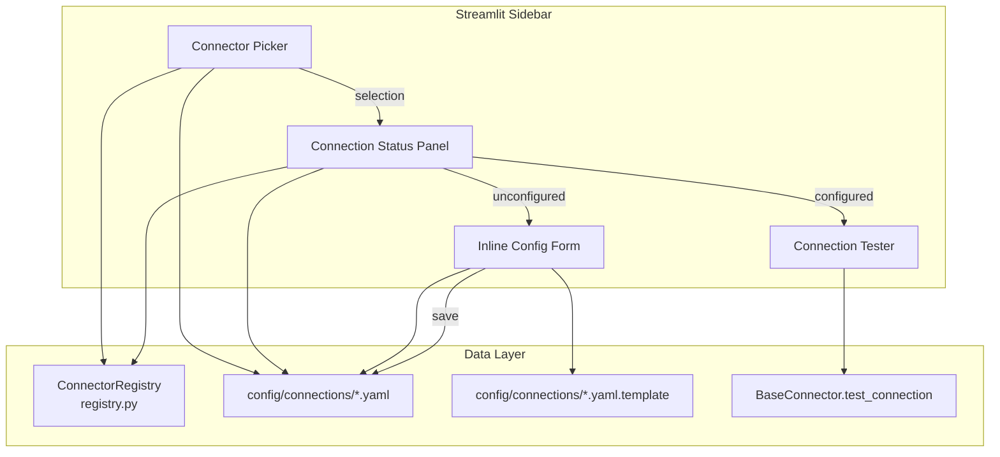

# Design Document: Streamlit Connector UI

## Overview

This feature enhances the Streamlit sidebar's data source section from a flat selectbox into a rich, grouped connector management panel. The new UI provides:

- Connectors organized into "AWS Native" and "External Platforms" groups with status icons
- A connection status panel showing live configuration details for the selected connector
- An inline configuration form that reads `.yaml.template` files and writes `.yaml` configs
- A connection tester that invokes `BaseConnector.test_connection()` with result display

All functionality lives in the sidebar and uses `st.session_state` for persistence across Streamlit rerenders. No new backend services are required - the feature leverages the existing connector registry, YAML config system, and `BaseConnector` interface.

## Architecture



### Key Design Decisions

1. **Single-file UI module**: All new UI components live in `scripts/streamlit_app.py` within the existing `_render_sidebar()` flow. This avoids import complexity and keeps the Streamlit rendering in one place.

2. **Pure helper functions extracted for testability**: Logic like connector grouping, status determination, name truncation, config validation, and template parsing is implemented as pure functions importable from a new `scripts/sidebar_helpers.py` module. This allows property-based testing without needing a Streamlit runtime.

3. **Template-driven forms**: The inline config form reads `.yaml.template` files to determine which fields to render. This means adding a new connector only requires adding a template file - no UI code changes needed.

4. **No database or external state**: Configuration is stored in YAML files on the filesystem, consistent with the existing pattern. Session state handles ephemeral UI state only.

## Components and Interfaces

### 1. SidebarHelpers Module (`scripts/sidebar_helpers.py`)

Pure functions extracted for testability:

```python
# Type definitions
ConnectorType = str  # e.g. "athena", "redshift", "rds_postgres"
ConnectorGroup = Literal["AWS Native", "External Platforms"]

# Constants
CONNECTOR_ORDER: list[tuple[ConnectorType, str, str]] = [
    # (type_key, display_name, emoji_icon)
    ("athena", "Athena", "☁️"),
    ("redshift", "Redshift", "🔴"),
    ("rds_postgres", "RDS PostgreSQL", "🐘"),
    ("rds_mysql", "RDS MySQL", "🐬"),
    ("snowflake", "Snowflake", "❄️"),
    ("databricks", "Databricks", "🧱"),
]

AWS_NATIVE_TYPES = {"athena", "redshift", "rds_postgres", "rds_mysql"}
EXTERNAL_TYPES = {"snowflake", "databricks"}

DIALECT_LABELS: dict[ConnectorType, str] = {
    "athena": "Athena SQL",
    "redshift": "Redshift SQL",
    "rds_postgres": "PostgreSQL",
    "rds_mysql": "MySQL",
    "snowflake": "Snowflake SQL",
    "databricks": "Spark SQL",
}

CONNECTOR_ICONS: dict[ConnectorType, str] = {
    "athena": "☁️",
    "redshift": "🔴",
    "rds_postgres": "🐘",
    "rds_mysql": "🐬",
    "snowflake": "❄️",
    "databricks": "🧱",
}


def group_connectors(
    connector_types: list[ConnectorType],
) -> dict[ConnectorGroup, list[ConnectorType]]:
    """Group connector types into AWS Native and External Platforms.
    
    Returns dict with two keys, each containing connectors in the fixed display order.
    """

def get_status_icon(connector_type: ConnectorType, config_dir: Path) -> str:
    """Return '✅' if a matching enabled YAML exists, '⚠️' otherwise."""

def resolve_active_selection(
    current_selection: str | None,
    available_types: list[ConnectorType],
) -> ConnectorType:
    """Return current_selection if in available_types, else first item."""

def get_connector_metadata(connector_type: ConnectorType) -> dict[str, str]:
    """Return dict with 'dialect_label' and 'icon' for the connector type."""

def truncate_name(name: str, max_length: int = 50) -> str:
    """Truncate name to max_length chars, adding '...' suffix if exceeded."""

def extract_template_fields(template_path: Path) -> list[dict[str, str]]:
    """Parse a .yaml.template file and return list of settings field dicts.
    
    Each dict has: {'key': field_name, 'placeholder': template_value}
    """

def validate_form_data(
    fields: list[str],
    values: dict[str, str],
) -> dict[str, str]:
    """Validate form submission.
    
    Returns dict of field_name -> error_message for invalid fields.
    Empty dict means all valid. Checks: non-empty, max 255 chars.
    """

def build_yaml_config(
    connector_type: ConnectorType,
    name: str,
    settings: dict[str, str],
) -> dict:
    """Build a config dict ready for YAML serialization with enabled: true."""

def extract_status_panel_data(config: dict) -> dict[str, str]:
    """Extract display fields from a loaded connector config.
    
    Returns dict with keys: type, host_or_account, database, status.
    """

def format_test_success(dialect: str, timestamp_iso: str) -> str:
    """Format a success badge string with dialect and ISO 8601 timestamp."""

def format_test_failure(error_message: str) -> str:
    """Format a failure display string preserving the original error message."""
```

### 2. ConnectorPicker Component

Renders grouped connector radio buttons in the sidebar:

```python
def _render_connector_picker() -> ConnectorType:
    """Render the grouped connector picker and return the selected type."""
    # 1. Get all connector types from CONNECTOR_ORDER
    # 2. Group into AWS Native / External Platforms
    # 3. For each group, render header + connector options with status icons
    # 4. Persist selection in st.session_state['active_connector_type']
    # 5. Handle fallback if previous selection unavailable
```

### 3. ConnectionStatusPanel Component

Displays configuration details for the selected connector:

```python
def _render_status_panel(connector_type: ConnectorType) -> None:
    """Render connection status for the selected connector type."""
    # If configured: show type, host, database, status indicator
    # If Athena: show Glue DB, region, workgroup
    # If unconfigured: show setup prompt with required fields from template
    # If config unreadable: show error indication
```

### 4. InlineConfigForm Component

Expandable form for configuring connectors:

```python
def _render_config_form(connector_type: ConnectorType) -> None:
    """Render inline configuration form for the connector type."""
    # 1. Load .yaml.template to get field definitions
    # 2. If existing .yaml with enabled:true, pre-populate values
    # 3. Render text_input for each field with template placeholders
    # 4. On submit: validate, write YAML, update session state
    # 5. If template missing: show error, disable submit
```

### 5. ConnectionTester Component

Test button and result display:

```python
def _render_connection_tester(connector_type: ConnectorType) -> None:
    """Render test connection button and results."""
    # 1. Only show if connector is configured
    # 2. On click: show spinner, disable button, call test_connection()
    # 3. Display success badge (dialect + ISO timestamp) or error message
```

### 6. Integration with Existing `_render_sidebar()`

The new components replace the current flat selectbox section:

```python
def _render_sidebar():
    # ... existing logo, ALB URL, AWS Configuration sections ...
    
    st.divider()
    
    # ── Data Source (NEW) ──
    st.markdown('<div class="sidebar-section-title">📊 Data Source</div>', ...)
    
    selected_type = _render_connector_picker()
    _render_status_panel(selected_type)
    _render_config_form(selected_type)
    _render_connection_tester(selected_type)
    
    st.divider()
    
    # ... existing actions (Clear, Reconnect, Logout), footer ...
```

## Data Models

### Session State Keys

| Key | Type | Purpose |
|-----|------|---------|
| `active_connector_type` | `str` | Currently selected connector type key |
| `test_result_{type}` | `dict` | Cached test result: `{success: bool, message: str, timestamp: str}` |
| `config_form_expanded` | `bool` | Whether the inline config form is expanded |
| `show_unconfigured_banner` | `bool` | Whether the unconfigured query banner is visible |
| `banner_connector_type` | `str` | Which connector type the banner refers to |

### YAML Configuration Structure (existing, unchanged)

```yaml
name: "Connection Display Name"
type: "connector_type_key"
enabled: true|false
settings:
  host: "..."
  port: 1234
  database: "..."
  # ... type-specific fields
```

### Template Field Extraction

Templates are parsed to produce:
```python
@dataclass
class TemplateField:
    key: str           # e.g. "host"
    placeholder: str   # e.g. "my-cluster.xxxx.eu-north-1.redshift.amazonaws.com"
    is_secret: bool    # True if key contains "secret" or "token" or "password"
```

Fields with `is_secret=True` render as `st.text_input(type="password")`.

### Connector Status Determination

```python
@dataclass
class ConnectorStatus:
    is_configured: bool
    config_path: Path | None
    error: str | None  # Set if file exists but is unreadable/invalid
```

Status is determined by checking `config/connections/` for a `.yaml` file matching the connector type with `enabled: true`.

## Correctness Properties

*A property is a characteristic or behavior that should hold true across all valid executions of a system - essentially, a formal statement about what the system should do. Properties serve as the bridge between human-readable specifications and machine-verifiable correctness guarantees.*

### Property 1: Connector grouping preserves completeness and order

*For any* subset of known connector types, grouping them into "AWS Native" and "External Platforms" SHALL produce exactly two groups whose union equals the input set, with each connector appearing in the correct group and in the fixed display order defined by CONNECTOR_ORDER.

**Validates: Requirements 1.1**

### Property 2: Status icon reflects configuration state

*For any* connector type and filesystem state, the status icon function SHALL return a green checkmark if and only if a YAML file for that connector type exists in the config directory with `enabled: true`, and an orange warning icon otherwise.

**Validates: Requirements 1.3**

### Property 3: Selection fallback to first available

*For any* list of available connector types and a current selection string, if the current selection is not in the available types list, the resolved selection SHALL be the first item in the list.

**Validates: Requirements 1.5**

### Property 4: Status panel extracts all required fields from config

*For any* valid connector configuration dict containing type, settings with host/account and database keys, the status panel data extraction function SHALL return a dict containing non-empty values for type, host_or_account, and database.

**Validates: Requirements 2.1**

### Property 5: Template parsing produces matching form fields

*For any* valid YAML template file containing a `settings` dict, the template field extraction function SHALL return a field entry for every key in the template's settings section, with the template value as placeholder.

**Validates: Requirements 2.2, 3.1, 3.7**

### Property 6: Configuration write/read round-trip

*For any* valid form data (all fields non-empty, each <= 255 characters) and connector type, writing the data as a YAML configuration file and reading it back SHALL produce an equivalent configuration with the same type, name, and settings values, with `enabled: true`.

**Validates: Requirements 3.2**

### Property 7: Validation flags exactly the empty required fields

*For any* set of required field names and a values dict where some fields are empty strings, the validation function SHALL return error entries for exactly the fields that are empty, and no errors for fields with non-empty values within the 255-character limit.

**Validates: Requirements 3.3**

### Property 8: Config pre-population matches stored values

*For any* valid YAML config with `enabled: true`, the pre-population function SHALL produce form values that match every key-value pair in the config's settings section.

**Validates: Requirements 3.4**

### Property 9: Test failure preserves error message

*For any* non-empty error message string, the failure formatting function SHALL produce output containing the exact original error message.

**Validates: Requirements 4.4**

### Property 10: Test success contains dialect and valid ISO 8601 timestamp

*For any* dialect string and current datetime, the success formatting function SHALL produce output containing the dialect string and a timestamp parseable as ISO 8601.

**Validates: Requirements 4.5**

### Property 11: Connector metadata mapping is total and correct

*For any* known connector type, the metadata function SHALL return the correct dialect label and icon as defined in the DIALECT_LABELS and CONNECTOR_ICONS constants.

**Validates: Requirements 5.1, 5.2**

### Property 12: Name truncation respects length bounds

*For any* string, if its length exceeds 50 characters the truncation function SHALL return a string of exactly 53 characters (50 + "..."), and if its length is 50 or fewer the function SHALL return the original string unchanged.

**Validates: Requirements 5.3**

### Property 13: Unconfigured connector query produces banner with connector type name

*For any* connector type in unconfigured state, attempting to submit a query SHALL produce a banner message that contains the connector type's display name.

**Validates: Requirements 6.1**

## Error Handling

| Scenario | Handling |
|----------|----------|
| YAML config file missing | Status shows "Not configured", inline form offered |
| YAML config file malformed/unreadable | Status shows "Configuration Error" with file path, form offered to re-enter |
| Template file missing | Config form shows error "Template unavailable", submit disabled |
| `test_connection()` raises exception | Error message displayed in red badge, button re-enabled |
| `test_connection()` times out | Streamlit spinner clears after 30s default, shows timeout message |
| Config write fails (permissions) | Form shows filesystem error, does not update status |
| Session state key missing | Fallback to defaults (first connector, form collapsed) |
| Connector type not in registry | Shown as selectable but with "Unsupported" status, form disabled |

All errors are displayed inline in the sidebar using `st.error()` or styled HTML badges. No errors propagate to the chat area except the intentional "unconfigured connector" banner (Requirement 6.1).

## Testing Strategy

### Unit Tests (example-based)

Located in `tests/test_sidebar_helpers.py`:

- Connector grouping with all 6 types produces correct groups
- Status icon for Athena (always configured via env)
- Template field extraction for each real template file
- Form validation with boundary cases (empty string, 255 chars, 256 chars)
- Config write for each connector type
- Truncation at exactly 50 characters
- Status panel data extraction for Athena vs External connectors
- Banner message includes correct connector name

### Property-Based Tests (Hypothesis)

Located in `tests/test_sidebar_properties.py`:

Uses the `hypothesis` library (already in project dependencies). Each property test runs a minimum of 100 iterations.

- **Property 1**: Grouping completeness and order (generate random subsets of connector types)
- **Property 2**: Status icon correctness (generate random config states)
- **Property 3**: Fallback selection (generate random type lists and selections)
- **Property 4**: Status panel field extraction (generate random valid configs)
- **Property 5**: Template-to-fields mapping (generate random settings dicts)
- **Property 6**: Config round-trip (generate random valid form data, write/read YAML)
- **Property 7**: Validation flags empty fields (generate random field sets with some empty)
- **Property 8**: Config pre-population (generate random valid configs)
- **Property 9**: Error message preservation (generate random error strings)
- **Property 10**: Success badge format (generate random dialect strings + datetimes)
- **Property 11**: Metadata mapping (for all connector types)
- **Property 12**: Name truncation (generate random strings of varying length)
- **Property 13**: Unconfigured query banner (generate random connector types)

**Property test configuration:**
- Library: `hypothesis` (already installed)
- Decorator: `@given(...)` with `@settings(max_examples=100)`
- Tag format in docstring: `Feature: streamlit-connector-ui, Property N: <description>`

### Integration Tests

- End-to-end sidebar rendering with mocked `st` module
- Config form submit writes correct YAML to temp directory
- Connection test button invokes `test_connection()` on correct connector instance

### Manual Testing

- Visual regression of sidebar layout across connector states
- Browser session persistence of active selection
- Responsiveness of status panel update on selection change (< 1 second requirement)
