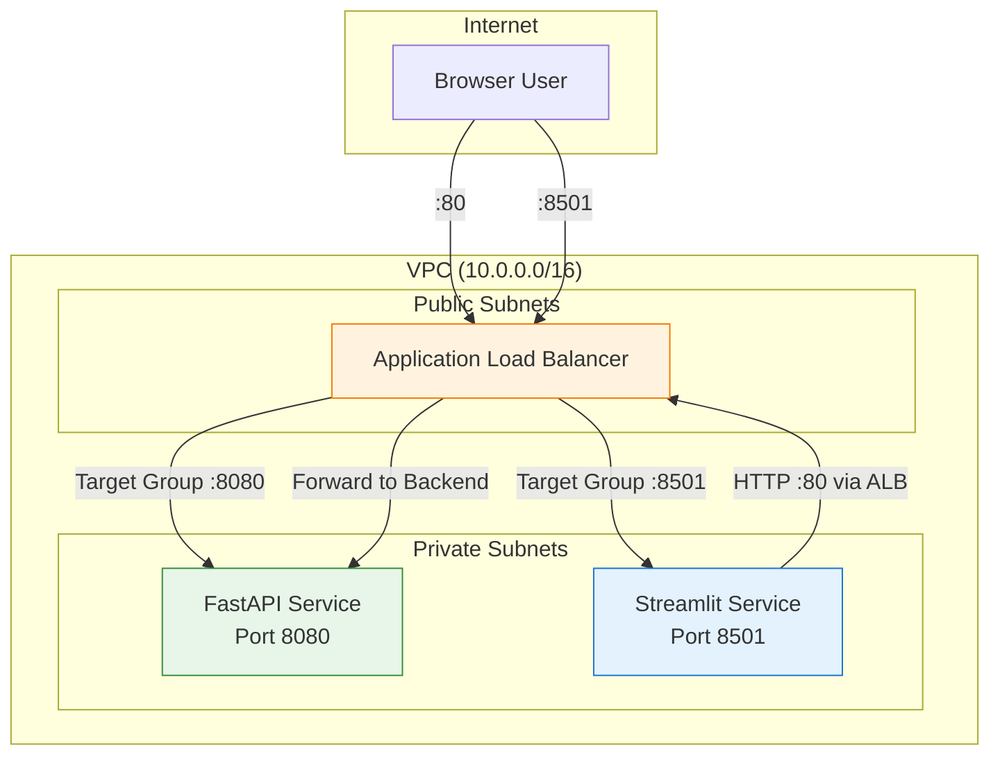

# Design Document: Streamlit ECS Deployment

## Overview

This design adds a second ECS Fargate service to the existing `cgs-ai-analyst-agent-project` CloudFormation stack, running the Streamlit chat UI alongside the FastAPI backend. The Streamlit service reuses the same Docker image (different entrypoint), shares the same VPC and ECS cluster, and is exposed through the existing ALB on a dedicated port (8501). The Streamlit container operates in "remote mode" - forwarding user queries to the backend API via the ALB on port 80.

### Design Decisions

1. **Same image, different entrypoint**: Avoids maintaining two Docker images and keeps frontend/backend versions in lockstep. The Streamlit task overrides the default `ENTRYPOINT` with a `Command` that launches Streamlit.

2. **Dedicated ALB listener on port 8501**: Simpler than path-based routing since Streamlit uses WebSockets (`/_stcore/stream`) which complicates path prefix routing. A dedicated port provides clean isolation.

3. **Intra-VPC routing for backend connectivity**: The Streamlit container reaches the backend through the ALB's internal VPC IP (10.0.x.x). Since the ALB is in public subnets within the same VPC, private subnet tasks can route to it without a NAT gateway - the VPC route table handles intra-VPC traffic directly.

4. **Shared security group**: The Streamlit service reuses `ServiceSecurityGroup` with an additional ingress rule for port 8501 from the ALB SG. This avoids creating a separate SG while maintaining the principle that only ALB traffic reaches ECS tasks.

5. **Minimal IAM**: The Streamlit container only needs CloudWatch Logs write access (via the execution role). It does not call AWS services directly - all data access flows through the backend API.

## Architecture



### Network Flow

1. **User to Streamlit**: Browser connects to `http://<alb-dns>:8501` - ALB listener on 8501 forwards to `StreamlitTargetGroup` - routed to Streamlit task on port 8501.
2. **Streamlit to Backend**: Streamlit container sends HTTP POST to `http://<alb-dns>:80/query` - ALB listener on 80 forwards to existing `TargetGroup` - routed to Backend task on port 8080.
3. **Backend to AWS**: Backend task uses VPC endpoints (Bedrock, Athena, Glue, S3) for data operations - no NAT gateway needed.

## Components and Interfaces

### New CloudFormation Resources

| Resource | Type | Purpose |
|----------|------|---------|
| `StreamlitTaskDefinition` | `AWS::ECS::TaskDefinition` | Defines Streamlit container (same image, different command) |
| `StreamlitService` | `AWS::ECS::Service` | Runs and maintains Streamlit tasks in the ECS cluster |
| `StreamlitTargetGroup` | `AWS::ElasticLoadBalancingV2::TargetGroup` | Routes ALB traffic to Streamlit tasks on port 8501 |
| `StreamlitListener` | `AWS::ElasticLoadBalancingV2::Listener` | ALB listener on port 8501 |
| `StreamlitLogGroup` | `AWS::Logs::LogGroup` | CloudWatch log group for Streamlit container logs |

### Modified Existing Resources

| Resource | Change |
|----------|--------|
| `AlbSecurityGroup` | Add ingress rule for TCP port 8501 from `AlbIngressCidr` |
| `ServiceSecurityGroup` | Add ingress rule for TCP port 8501 from `AlbSecurityGroup` |

### Port Consistency Validation

The Streamlit listener port (8501), target group port (8501), and security group ingress rules (8501) must all reference the same port. The CloudFormation template uses a consistent literal value (`8501`) across all three resource definitions to prevent misconfiguration. Any port mismatch would cause deployment-time connectivity failures.

### New Stack Parameters

| Parameter | Type | Default | Description |
|-----------|------|---------|-------------|
| `StreamlitDesiredCount` | Number | 1 | Fargate task count for Streamlit service |
| `StreamlitUsername` | String | (none) | Login username for Streamlit UI |
| `StreamlitPassword` | String (NoEcho) | (none) | Login password for Streamlit UI |

### New Stack Outputs

| Output | Value | Description |
|--------|-------|-------------|
| `StreamlitUrl` | `http://${ALB.DNSName}:8501` | Streamlit Chat UI URL |

### Dockerfile Change

Add `.streamlit/config.toml` to the image:

```dockerfile
COPY .streamlit /app/.streamlit
```

This line goes after the existing `COPY config /app/config` instruction. It makes the Streamlit theme and server configuration available inside the container.

## Data Models

No new data models are introduced. The Streamlit service communicates with the backend using the existing HTTP API contract:

```
POST /query
Request:  { "question": "<string>" }
Response: { "answer": "<string>" }
Headers:  X-Api-Key: <optional>
```

### Environment Variables (Streamlit Task)

| Variable | Source | Purpose |
|----------|--------|---------|
| `API_URL` | ALB DNS (port 80) | Backend endpoint for query forwarding |
| `API_KEY` | `ApiKey` parameter (conditional) | Auth header for backend API |
| `APP_USERNAME` | `StreamlitUsername` parameter | Login gate username |
| `APP_PASSWORD` | `StreamlitPassword` parameter | Login gate password |

## Error Handling

| Scenario | Handling |
|----------|----------|
| Backend unreachable | Streamlit displays HTTP error from `requests.post` timeout (300s) with status code |
| Invalid credentials | Streamlit login form shows "Invalid username or password" - session not granted |
| Session management | Streamlit actively tracks session continuity via session_state; session terminates on Logout click or expiry |
| Missing APP_USERNAME/APP_PASSWORD | Streamlit shows configuration error, refuses all access |
| Container health check fails | ALB marks task unhealthy after 3 consecutive failures; ECS replaces the task |
| Task fails to start | ECS retries task placement; ALB routes only to healthy tasks. Image must exist in ECR before setting DesiredCount > 0 |
| ALB 502/503 during deploy | `HealthCheckGracePeriodSeconds=120` gives the container time to start before ALB checks begin |

## Testing Strategy

Since this feature is entirely Infrastructure as Code (CloudFormation resource definitions) with no custom application logic changes, property-based testing does not apply. The Streamlit app code already exists and is unchanged.

### Testing Approach

**Unit tests** are not applicable - the changes are declarative CloudFormation YAML, not executable code.

**Integration/validation tests** (post-deployment):

1. **Template validation**: `aws cloudformation validate-template` to catch syntax errors
2. **Change set review**: Deploy via change set (`deploy-changeset.sh`) to review planned changes before execution
3. **Smoke test - Streamlit health**: After deployment with `StreamlitDesiredCount=1`, verify `http://<alb-dns>:8501/_stcore/health` returns 200
4. **Smoke test - login flow**: Access `http://<alb-dns>:8501`, verify login form appears, submit valid credentials, verify session access
5. **Smoke test - query flow**: After login, submit a question in the Streamlit UI, verify it returns an answer from the backend
6. **Smoke test - backend isolation**: Verify the backend service on port 80 continues responding normally after stack update

### Why PBT Does Not Apply

This feature adds CloudFormation resources (task definitions, services, listeners, target groups). These are declarative configurations with no input/output functions to property-test. The correct validation approach is:
- Template lint/validation (cfn-lint)
- Change set review (human inspection of planned changes)
- Post-deployment smoke tests (verify actual AWS resources work end-to-end)
